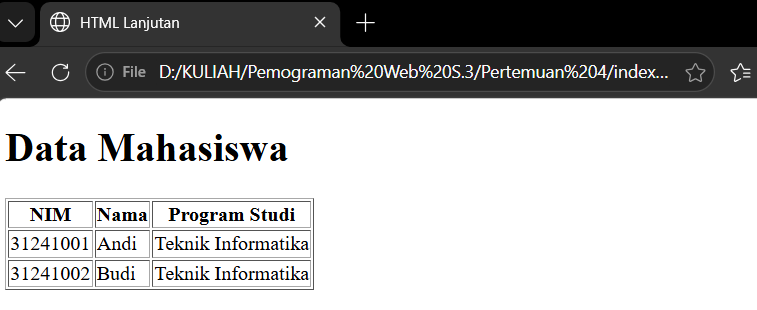

# Lab1Web

Repository ini berisi hasil praktikum Pertemuan 4 pemograman web.

## 1. Membuat tabel pada HTML

Pada tahap ini Kita mempelajari cara membuat sebuah tabel pada HTML.

### Hasil

---

## 2. Membuat struktur tabel pada HTML

Pada tahap ini kita belajar membuat struktur tabel menggunakan thead, tbody, dan tfoot serta fungsi colspan pada HTML

### Hasil

---

## 3. Membuat form pada HTML

Pada tahap ini mempelajari bagaimanan cara membuat sebuah form pada HTML
### Hasil

---

## 4. Menggunakan radio button dan checkbox
Pada tahap ini mempelajari bagaimanan cara menggunakan radio button dan checbox dan fungsinya

### Hasil

---

## 5. Mengatur Ukuran Gambar
Untuk mengatur ukuran gambar dapat digunakan atribut width dan height.

### Hasil

---

## 6. Menambahkan Hyperlink
Pada tahap ini mempelajari cara membuat hyperlink

### Hasil

---

## 7. Menambahkan List
Pada tahap ini mempelajari cara menambahkan list pada HTML.

### Hasil

---

## 8. Kesimpulan

Pada praktikum ini saya mempelajari dasar-dasar pembuatan halaman web
menggunakan HTML, mulai dari membuat struktur dokumen HTML, heading,
paragraph, hyperlink, mennyisipkan gambar, membuat list dan mengatur ukuran gambar.

