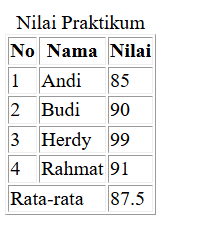
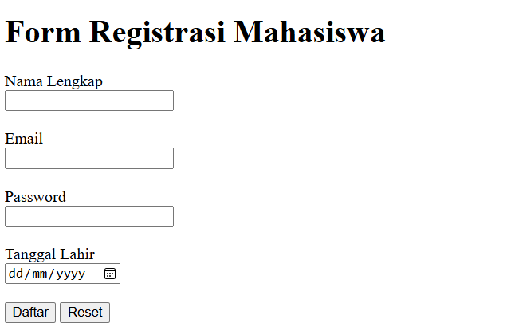
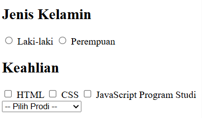
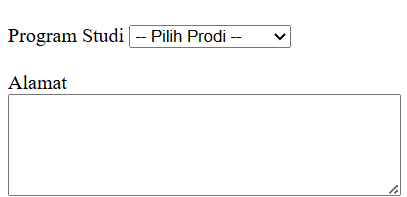
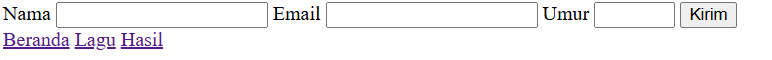
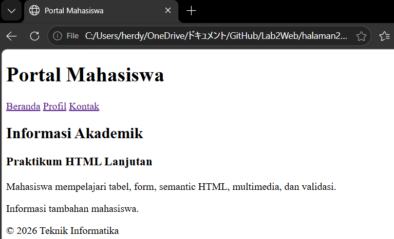
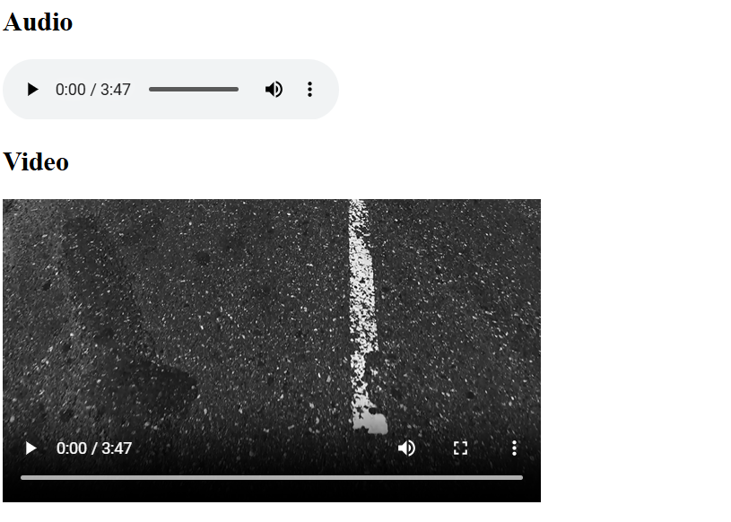
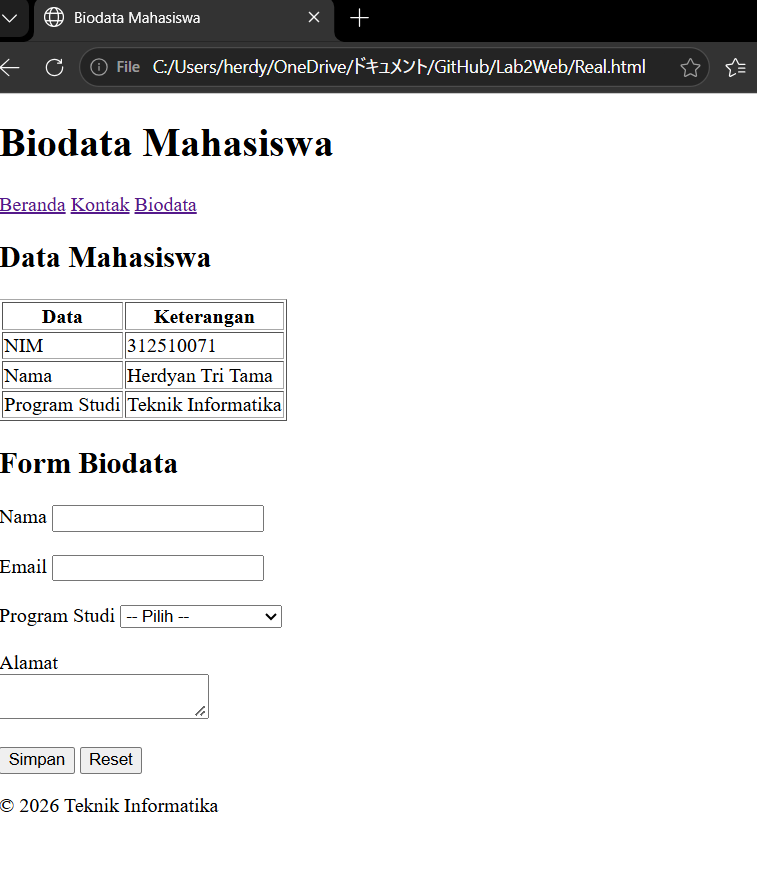

# Lab1Web

Repository ini berisi hasil praktikum Pertemuan 4 pemograman web.

## 1. Membuat tabel pada HTML

Pada tahap ini Kita mempelajari cara membuat sebuah tabel pada HTML.

### Hasil

---

## 2. Membuat struktur tabel pada HTML

Pada tahap ini kita belajar membuat struktur tabel menggunakan thead, tbody, dan tfoot serta fungsi colspan pada HTML

### Hasil

---

## 3. Membuat form pada HTML

Pada tahap ini mempelajari bagaimanan cara membuat sebuah form pada HTML
### Hasil

---

## 4. Menggunakan radio button dan checkbox
Pada tahap ini mempelajari bagaimanan cara menggunakan radio button dan checbox dan fungsinya pada HTML.

### Hasil

---

## 5. Menggunakan select dan textarea
mempelajari fungsi dan cara mengugnakan select dan textarea.

### Hasil

---

## 6. Menambahkan validasi form dasar pada HTML.
Pada tahap ini mempelajari cara membuat Validasi form dasar.

### Hasil

---

## 7. Membuat halaman semantic HTML
Pada tahap ini mempelajari cara membuat sebuah halaman semantic HTML.

### Hasil

---

## 8. Menambahakan multimedia pada HTML
Pada tahap ini mempelajari cara menambahkan multimedia pada HTML.
### Hasil

---

## 9. proyek mini pada HTML
Pada tahap ini membuat sebuah proyek mini pada HTML.
### Hasil

---

## 10. Kesimpulan

Pada praktikum ini saya mempelajari cara pembuatan sebuah tabel dan membuat biodata sederhana menggunakan HTML.

